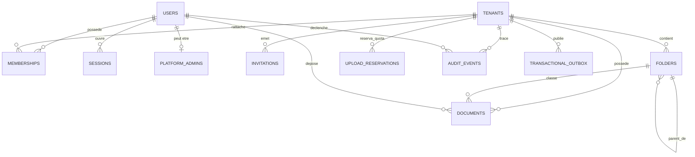

# DocuPro V1 — Modèle de Données Logique (Lot B)

> **Statut du document** : Rédigé et proposé par l'agent technique — En attente de revue et validation par le porteur du projet.  
> **Avertissement d'exécution** : Ce modèle n'a fait l'objet d'aucune migration en base réelle à ce stade (Docker étant à l'arrêt). Les schémas SQL et Prisma ci-dessous sont indicatifs et vérifiables pour l'instant uniquement par analyse statique.

---

## 1. Vue d'Ensemble & Diagramme Entités-Relations

Le modèle sépare formellement deux catégories de données :
1. **Données Globales de la Plateforme** : Utilisateurs uniques, administrateurs système, organisations clientes (`tenants`), sessions d'authentification globales et journaux d'audit de sécurité globale.
2. **Données Cloisonnées d'Entreprise** : Appartenances (`memberships`), invitations, arborescence de dossiers, fiches documentaires, réservations de quotas d'importation, événements d'audit d'entreprise et événements d'outbox asynchrone.



---

## 2. Dictionnaire des Données

### 2.1. Données Globales (Non soumises à la RLS entreprise)

#### A. Table `users` (Identité globale)
*Responsabilité* : Représente une personne physique unique sur la plateforme.

| Colonne | Type PostgreSQL | Nullable | Contraintes / Défaut | Description |
| :--- | :--- | :---: | :--- | :--- |
| `id` | `UUID` | Non | `PRIMARY KEY DEFAULT gen_random_uuid()` | Identifiant immuable. |
| `email` | `VARCHAR(255)` | Non | `UNIQUE` (insensible à la casse via index) | Adresse email normalisée en minuscules. |
| `password_hash` | `VARCHAR(255)` | Non | - | Hash Argon2id ou bcrypt du mot de passe. |
| `first_name` | `VARCHAR(100)` | Non | - | Prénom de l'utilisateur. |
| `last_name` | `VARCHAR(100)` | Non | - | Nom de famille. |
| `is_active` | `BOOLEAN` | Non | `DEFAULT true` | Statut du compte global. Si `false`, bloque toute session. |
| `is_email_verified`| `BOOLEAN` | Non | `DEFAULT false` | Indique si l'adresse a été validée. |
| `email_verify_token_hash` | `VARCHAR(64)` | Oui | - | Hash SHA-256 du jeton de vérification. |
| `email_verify_token_expires` | `TIMESTAMPTZ` | Oui | - | Expiration du jeton de vérification (max 48h). |
| `password_reset_token_hash` | `VARCHAR(64)` | Oui | - | Hash SHA-256 du jeton de réinitialisation. |
| `password_reset_expires` | `TIMESTAMPTZ` | Oui | - | Expiration courte du jeton (max 30 min). |
| `mfa_secret_encrypted` | `VARCHAR(500)` | Oui | - | Secret TOTP chiffré au repos (AES-256-GCM). |
| `is_mfa_enabled` | `BOOLEAN` | Non | `DEFAULT false` | Statut d'activation du MFA. |
| `mfa_recovery_codes_hashes`| `JSONB` | Oui | - | Tableau de 8 hashs des codes de secours à usage unique. |
| `created_at` | `TIMESTAMPTZ` | Non | `DEFAULT NOW()` | Date d'inscription. |
| `updated_at` | `TIMESTAMPTZ` | Non | `DEFAULT NOW()` | Dernière mise à jour. |

#### B. Table `platform_admins` (Gouvernance technique)
*Responsabilité* : Attribue les prérogatives d'administration globale de la plateforme à certains comptes utilisateurs.

| Colonne | Type PostgreSQL | Nullable | Contraintes / Défaut | Description |
| :--- | :--- | :---: | :--- | :--- |
| `id` | `UUID` | Non | `PRIMARY KEY DEFAULT gen_random_uuid()` | Identifiant technique. |
| `user_id` | `UUID` | Non | `UNIQUE REFERENCES users(id) ON DELETE CASCADE` | Référence vers le compte utilisateur global. |
| `role` | `VARCHAR(50)` | Non | `DEFAULT 'SUPER_ADMIN'` | Rôle plateforme (`SUPER_ADMIN`, `SUPPORT`). |
| `created_at` | `TIMESTAMPTZ` | Non | `DEFAULT NOW()` | Date d'attribution du rôle. |

#### C. Table `tenants` (Organisations clientes)
*Responsabilité* : Fiche d'une entreprise cliente souscrivant au service SaaS.

| Colonne | Type PostgreSQL | Nullable | Contraintes / Défaut | Description |
| :--- | :--- | :---: | :--- | :--- |
| `id` | `UUID` | Non | `PRIMARY KEY DEFAULT gen_random_uuid()` | Identifiant unique de l'entreprise (`tenant_id`). |
| `name` | `VARCHAR(255)` | Non | - | Raison sociale / Nom commercial. |
| `slug` | `VARCHAR(100)` | Non | `UNIQUE` | Identifiant textuel normalisé (kebab-case). |
| `status` | `VARCHAR(20)` | Non | `DEFAULT 'ACTIVE'` | Statut : `ACTIVE`, `SUSPENDED`, `CLOSED`. |
| `logo_storage_key` | `VARCHAR(500)` | Oui | - | Clé S3 du logo d'entreprise. |
| `contact_email` | `VARCHAR(255)` | Oui | - | Email officiel de l'entreprise. |
| `contact_phone` | `VARCHAR(50)` | Oui | - | Téléphone de contact. |
| `storage_quota_bytes` | `BIGINT` | Non | `DEFAULT 5368709120` | Quota alloué en octets (5 Go par défaut). |
| `storage_used_bytes` | `BIGINT` | Non | `DEFAULT 0` | Espace réel consommé (originaux + corbeille). |
| `storage_reserved_bytes` | `BIGINT` | Non | `DEFAULT 0` | Espace réservé pour les imports en cours d'analyse. |
| `created_at` | `TIMESTAMPTZ` | Non | `DEFAULT NOW()` | Date de création de l'entreprise. |
| `updated_at` | `TIMESTAMPTZ` | Non | `DEFAULT NOW()` | Horodatage de modification. |

#### D. Table `sessions` (Sessions serveur sécurisées)
*Responsabilité* : Suivi des sessions actives avec cookies opaques et révocation immédiate.

| Colonne | Type PostgreSQL | Nullable | Contraintes / Défaut | Description |
| :--- | :--- | :---: | :--- | :--- |
| `id` | `UUID` | Non | `PRIMARY KEY DEFAULT gen_random_uuid()` | Identifiant technique de session. |
| `user_id` | `UUID` | Non | `REFERENCES users(id) ON DELETE CASCADE` | Utilisateur authentifié. |
| `session_token_hash` | `VARCHAR(64)` | Non | `UNIQUE` | Hash SHA-256 du jeton opaque contenu dans le cookie. |
| `ip_address` | `VARCHAR(45)` | Oui | - | Adresse IP cliente (IPv4 ou IPv6). |
| `user_agent` | `TEXT` | Oui | - | Signature du navigateur/client. |
| `last_active_at` | `TIMESTAMPTZ` | Non | `DEFAULT NOW()` | Horodatage pour expiration glissante (2h). |
| `expires_at` | `TIMESTAMPTZ` | Non | - | Expiration absolue (24h après création). |
| `revoked_at` | `TIMESTAMPTZ` | Oui | - | Révocation manuelle ou consécutive à un reset. |
| `created_at` | `TIMESTAMPTZ` | Non | `DEFAULT NOW()` | Date de création de la session. |

---

### 2.2. Données d'Entreprise (Cloisonnées par `tenant_id` + RLS)

#### E. Table `memberships` (Rattachement Utilisateur - Entreprise)
*Responsabilité* : Définit les droits et le rôle d'un utilisateur au sein d'une organisation.

| Colonne | Type PostgreSQL | Nullable | Contraintes / Défaut | Description |
| :--- | :--- | :---: | :--- | :--- |
| `id` | `UUID` | Non | `PRIMARY KEY DEFAULT gen_random_uuid()` | Identifiant d'appartenance. |
| `tenant_id` | `UUID` | Non | `REFERENCES tenants(id) ON DELETE RESTRICT` | Entreprise de rattachement. |
| `user_id` | `UUID` | Non | `REFERENCES users(id) ON DELETE CASCADE` | Utilisateur membre. |
| `role` | `VARCHAR(30)` | Non | `DEFAULT 'VIEWER'` | Rôle : `ADMIN`, `DOCUMENT_MANAGER`, `CONTRIBUTOR`, `VIEWER`. |
| `status` | `VARCHAR(20)` | Non | `DEFAULT 'ACTIVE'` | Statut : `INVITED`, `ACTIVE`, `SUSPENDED`. |
| `created_at` | `TIMESTAMPTZ` | Non | `DEFAULT NOW()` | Date d'adhésion. |
| `updated_at` | `TIMESTAMPTZ` | Non | `DEFAULT NOW()` | Horodatage de modification. |

*Contraintes d'intégrité* :
* `UNIQUE (tenant_id, user_id)` : un utilisateur ne peut avoir qu'un seul profil par entreprise.
* `UNIQUE (tenant_id, id)` : requis pour former des clés composites avec les autres tables de l'entreprise.

#### F. Table `invitations` (Invitations de membres)
*Responsabilité* : Gère les demandes de rattachement en attente.

| Colonne | Type PostgreSQL | Nullable | Contraintes / Défaut | Description |
| :--- | :--- | :---: | :--- | :--- |
| `id` | `UUID` | Non | `PRIMARY KEY DEFAULT gen_random_uuid()` | Identifiant technique. |
| `tenant_id` | `UUID` | Non | `REFERENCES tenants(id) ON DELETE CASCADE` | Entreprise émettrice. |
| `email` | `VARCHAR(255)` | Non | - | Email du collaborateur invité. |
| `role` | `VARCHAR(30)` | Non | `DEFAULT 'VIEWER'` | Rôle proposé à l'invitation. |
| `token_hash` | `VARCHAR(64)` | Non | `UNIQUE` | Hash SHA-256 du jeton d'invitation à usage unique. |
| `invited_by_user_id` | `UUID` | Non | `REFERENCES users(id) ON DELETE RESTRICT` | Auteur de l'invitation (Admin). |
| `status` | `VARCHAR(20)` | Non | `DEFAULT 'PENDING'` | Statut : `PENDING`, `ACCEPTED`, `REVOKED`, `EXPIRED`. |
| `expires_at` | `TIMESTAMPTZ` | Non | - | Expiration fixée à 48h. |
| `accepted_at` | `TIMESTAMPTZ` | Oui | - | Date effective d'acceptation. |
| `created_at` | `TIMESTAMPTZ` | Non | `DEFAULT NOW()` | Date d'envoi. |

#### G. Table `folders` (Arborescence documentaire)
*Responsabilité* : Organisation hiérarchique des dossiers dans l'entreprise.

| Colonne | Type PostgreSQL | Nullable | Contraintes / Défaut | Description |
| :--- | :--- | :---: | :--- | :--- |
| `id` | `UUID` | Non | `PRIMARY KEY DEFAULT gen_random_uuid()` | Identifiant du dossier. |
| `tenant_id` | `UUID` | Non | `REFERENCES tenants(id) ON DELETE CASCADE` | Entreprise propriétaire. |
| `parent_id` | `UUID` | Oui | - | Dossier parent (`NULL` = racine virtuelle). |
| `name` | `VARCHAR(100)` | Non | - | Nom du dossier (rogné sans espaces superflus). |
| `depth` | `SMALLINT` | Non | `DEFAULT 1` | Niveau dans l'arborescence (1 à 5). |
| `created_by_user_id` | `UUID` | Non | `REFERENCES users(id) ON DELETE RESTRICT` | Créateur du dossier. |
| `is_deleted` | `BOOLEAN` | Non | `DEFAULT false` | Marqueur de mise à la corbeille. |
| `deleted_at` | `TIMESTAMPTZ` | Oui | - | Date de mise à la corbeille. |
| `created_at` | `TIMESTAMPTZ` | Non | `DEFAULT NOW()` | Date de création. |
| `updated_at` | `TIMESTAMPTZ` | Non | `DEFAULT NOW()` | Horodatage de modification. |

*Contraintes composites anti-fuite inter-tenants* :
* `UNIQUE (tenant_id, id)` : clé composite pour contraindre la relation parent-enfant.
* `FOREIGN KEY (tenant_id, parent_id) REFERENCES folders(tenant_id, id) ON DELETE RESTRICT` : **empêche formellement qu'un dossier d'une entreprise ait pour parent un dossier d'une autre entreprise**.
* Contrainte de profondeur : `CHECK (depth >= 1 AND depth <= 5)`.

#### H. Table `documents` (Fiches documentaires et fichiers originaux)
*Responsabilité* : Métadonnées métier et pointage vers l'objet de stockage original immuable.

| Colonne | Type PostgreSQL | Nullable | Contraintes / Défaut | Description |
| :--- | :--- | :---: | :--- | :--- |
| `id` | `UUID` | Non | `PRIMARY KEY DEFAULT gen_random_uuid()` | Identifiant du document. |
| `tenant_id` | `UUID` | Non | `REFERENCES tenants(id) ON DELETE CASCADE` | Entreprise propriétaire. |
| `folder_id` | `UUID` | Oui | - | Dossier de classement (`NULL` = à la racine). |
| `title` | `VARCHAR(255)` | Non | - | Titre du document. |
| `reference` | `VARCHAR(100)` | Oui | - | Référence interne (non bloquante). |
| `description` | `TEXT` | Oui | - | Description libre (max 2 000 caractères). |
| `document_type` | `VARCHAR(50)` | Non | `DEFAULT 'AUTRE'` | Type normalisé (`FACTURE`, `CONTRAT`, etc.). |
| `document_date` | `DATE` | Oui | - | Date d'émission métier. |
| `status` | `VARCHAR(30)` | Non | `DEFAULT 'QUARANTINED'` | `QUARANTINED`, `SCANNING`, `SCAN_FAILED_TEMPORARY`, `REJECTED_SECURITY`, `REJECTED_FORMAT`, `READY`. |
| `rejection_reason` | `TEXT` | Oui | - | Motif technique ou sécuritaire de rejet. |
| `original_filename` | `VARCHAR(255)` | Non | - | Nom du fichier fourni au téléversement. |
| `file_size_bytes` | `BIGINT` | Non | - | Taille exacte en octets (max 50 Mo). |
| `mime_type` | `VARCHAR(100)` | Non | - | Type MIME réel validé (`application/pdf`, `image/jpeg`, `image/png`). |
| `sha256_hash` | `VARCHAR(64)` | Non | - | Empreinte cryptographique de l'original. |
| `storage_key` | `VARCHAR(500)` | Non | - | Clé S3 de l'original (`documents/.../original`). |
| `preview_storage_key`| `VARCHAR(500)` | Oui | - | Clé S3 de la miniature/aperçu généré. |
| `created_by_user_id`| `UUID` | Non | `REFERENCES users(id) ON DELETE RESTRICT` | Déposant (propriétaire initial). |
| `is_deleted` | `BOOLEAN` | Non | `DEFAULT false` | Marqueur corbeille. |
| `deleted_at` | `TIMESTAMPTZ` | Oui | - | Date de mise à la corbeille. |
| `created_at` | `TIMESTAMPTZ` | Non | `DEFAULT NOW()` | Date de dépôt. |
| `updated_at` | `TIMESTAMPTZ` | Non | `DEFAULT NOW()` | Dernière mise à jour des métadonnées. |

*Contraintes composites anti-fuite inter-tenants* :
* `FOREIGN KEY (tenant_id, folder_id) REFERENCES folders(tenant_id, id) ON DELETE SET NULL` : **garantit qu'un document du Tenant A ne peut jamais être rattaché à un dossier du Tenant B**.

#### I. Table `upload_reservations` (Gestion atomique des quotas)
*Responsabilité* : Enregistrement de chaque opération d'import pour réserver le stockage et garantir la libération idempotente.

| Colonne | Type PostgreSQL | Nullable | Contraintes / Défaut | Description |
| :--- | :--- | :---: | :--- | :--- |
| `id` | `UUID` | Non | `PRIMARY KEY DEFAULT gen_random_uuid()` | Identifiant de l'opération d'import. |
| `tenant_id` | `UUID` | Non | `REFERENCES tenants(id) ON DELETE CASCADE` | Entreprise concernée. |
| `user_id` | `UUID` | Non | `REFERENCES users(id) ON DELETE RESTRICT` | Utilisateur initiant l'upload. |
| `document_id` | `UUID` | Oui | - | Fiche document associée après création. |
| `reserved_bytes` | `BIGINT` | Non | - | Taille réservée sur le quota. |
| `status` | `VARCHAR(20)` | Non | `DEFAULT 'PENDING'` | `PENDING`, `CONFIRMED`, `CANCELLED`, `EXPIRED`. |
| `quarantine_key` | `VARCHAR(500)` | Non | - | Emplacement temporaire (`quarantine/...`). |
| `expires_at` | `TIMESTAMPTZ` | Non | - | Expiration de la réservation (30 minutes). |
| `confirmed_at` | `TIMESTAMPTZ` | Oui | - | Horodatage de promotion en stockage final. |
| `released_at` | `TIMESTAMPTZ` | Oui | - | Horodatage de libération du quota réservé. |
| `created_at` | `TIMESTAMPTZ` | Non | `DEFAULT NOW()` | Date d'initiation. |

*Règles d'intégrité* :
* Une réservation `PENDING` non confirmée après `expires_at` est libérée par un cron de maintenance sans risque de double décompte.

#### J. Table `audit_events` (Traçabilité immuable append-only)
*Responsabilité* : Journal d'audit légal et opérationnel.

| Colonne | Type PostgreSQL | Nullable | Contraintes / Défaut | Description |
| :--- | :--- | :---: | :--- | :--- |
| `id` | `UUID` | Non | `PRIMARY KEY DEFAULT gen_random_uuid()` | Identifiant de l'événement. |
| `tenant_id` | `UUID` | Oui | `REFERENCES tenants(id) ON DELETE RESTRICT` | Entreprise visée (`NULL` pour événements plateforme/sécurité globale). |
| `actor_user_id` | `UUID` | Oui | `REFERENCES users(id) ON DELETE SET NULL` | Utilisateur à l'origine de l'action (`NULL` si anonyme/système). |
| `action` | `VARCHAR(100)` | Non | - | Code normalisé (ex: `document.download`, `auth.login_failure`). |
| `target_type` | `VARCHAR(50)` | Non | - | Entité cible (`DOCUMENT`, `FOLDER`, `MEMBER`, `TENANT`, `AUTH`). |
| `target_id` | `VARCHAR(100)` | Non | - | Identifiant de la cible. |
| `details` | `JSONB` | Oui | - | Métadonnées contextuelles (sans mots de passe ni binaire). |
| `ip_address` | `VARCHAR(45)` | Oui | - | Adresse IP de l'acteur. |
| `user_agent` | `TEXT` | Oui | - | User-Agent du client. |
| `created_at` | `TIMESTAMPTZ` | Non | `DEFAULT NOW()` | Horodatage immuable de l'événement. |

*Garantie de non-suppression* :
* `ON DELETE RESTRICT` sur `tenant_id` : la suppression d'un tenant est bloquée tant que ses logs d'audit légaux ne sont pas purgés ou archivés selon une procédure juridique distincte.

#### K. Table `transactional_outbox` (Publication fiable des événements asynchrones)
*Responsabilité* : Garantit la cohérence entre PostgreSQL et BullMQ (Pattern Transactional Outbox).

| Colonne | Type PostgreSQL | Nullable | Contraintes / Défaut | Description |
| :--- | :--- | :---: | :--- | :--- |
| `id` | `UUID` | Non | `PRIMARY KEY DEFAULT gen_random_uuid()` | Identifiant du message outbox. |
| `tenant_id` | `UUID` | Non | `REFERENCES tenants(id) ON DELETE CASCADE` | Entreprise associée. |
| `event_type` | `VARCHAR(100)` | Non | - | Type d'événement (ex: `document.scan_requested`). |
| `payload` | `JSONB` | Non | - | Charge utile (identifiants uniquement, sans binaire ni mot de passe). |
| `status` | `VARCHAR(20)` | Non | `DEFAULT 'PENDING'` | `PENDING`, `DISPATCHED`, `FAILED`. |
| `retry_count` | `INTEGER` | Non | `DEFAULT 0` | Nombre de tentatives d'envoi vers BullMQ. |
| `last_error` | `TEXT` | Oui | - | Erreur retournée en cas d'échec de dispatch. |
| `created_at` | `TIMESTAMPTZ` | Non | `DEFAULT NOW()` | Date d'insertion dans la transaction métier. |
| `dispatched_at` | `TIMESTAMPTZ` | Oui | - | Date de prise en charge par le dispatcher. |

---

## 3. Index Proposés et Contraintes d'Unicité

```sql
-- 1. Index d'unicité insensibles à la casse pour les utilisateurs
CREATE UNIQUE INDEX idx_users_email_lower ON users (LOWER(email));

-- 2. Index de sessions actives
CREATE INDEX idx_sessions_user_active ON sessions (user_id) WHERE revoked_at IS NULL;
CREATE INDEX idx_sessions_token_hash ON sessions (session_token_hash);

-- 3. Clé composite obligatoire pour les relations folders/documents inter-tenants
ALTER TABLE folders ADD CONSTRAINT uq_folders_tenant_id_id UNIQUE (tenant_id, id);
ALTER TABLE memberships ADD CONSTRAINT uq_memberships_tenant_id_id UNIQUE (tenant_id, id);

-- 4. Unicité du nom de dossier par niveau et par entreprise parmi les dossiers ACTIFS (non supprimés)
-- Gestion de la racine virtuelle (parent_id IS NULL) via COALESCE
CREATE UNIQUE INDEX idx_folders_unique_active_name 
ON folders (tenant_id, COALESCE(parent_id, '00000000-0000-0000-0000-000000000000'::uuid), LOWER(name))
WHERE is_deleted = false;

-- 5. Index de recherche pour les documents
CREATE INDEX idx_documents_tenant_folder ON documents (tenant_id, folder_id) WHERE is_deleted = false;
CREATE INDEX idx_documents_tenant_status ON documents (tenant_id, status);
CREATE INDEX idx_documents_tenant_created ON documents (tenant_id, created_at DESC) WHERE is_deleted = false;
CREATE INDEX idx_documents_tenant_type ON documents (tenant_id, document_type) WHERE is_deleted = false;
CREATE INDEX idx_documents_search_meta ON documents (tenant_id, LOWER(title), LOWER(reference)) WHERE is_deleted = false;

-- 6. Index Outbox pour le dispatcher
CREATE INDEX idx_outbox_pending ON transactional_outbox (created_at ASC) WHERE status = 'PENDING';

-- 7. Index Audit
CREATE INDEX idx_audit_tenant_created ON audit_events (tenant_id, created_at DESC);
CREATE INDEX idx_audit_platform ON audit_events (created_at DESC) WHERE tenant_id IS NULL;
```

---

## 4. Ébauche du Schéma Prisma Indicatif (`schema.prisma`)

> ⚠️ **Avertissement d'intégrité** : Cette ébauche est fournie à titre indicatif pour analyse statique. Elle n'a été soumise à aucune commande `prisma migrate` ou `db push` sur une base de données active.

```prisma
datasource db {
  provider = "postgresql"
  url      = env("DATABASE_URL")
}

generator client {
  provider = "prisma-client-js"
}

// ----------------------------------------------------
// TABLES GLOBALES
// ----------------------------------------------------
model User {
  id                      String            @id @default(uuid()) @db.Uuid
  email                   String            @unique @db.VarChar(255)
  passwordHash            String            @map("password_hash") @db.VarChar(255)
  firstName               String            @map("first_name") @db.VarChar(100)
  lastName                String            @map("last_name") @db.VarChar(100)
  isActive                Boolean           @default(true) @map("is_active")
  isEmailVerified         Boolean           @default(false) @map("is_email_verified")
  emailVerifyTokenHash    String?           @map("email_verify_token_hash") @db.VarChar(64)
  emailVerifyTokenExpires DateTime?         @map("email_verify_token_expires") @db.Timestamptz
  passwordResetTokenHash  String?           @map("password_reset_token_hash") @db.VarChar(64)
  passwordResetExpires    DateTime?         @map("password_reset_expires") @db.Timestamptz
  mfaSecretEncrypted      String?           @map("mfa_secret_encrypted") @db.VarChar(500)
  isMfaEnabled            Boolean           @default(false) @map("is_mfa_enabled")
  mfaRecoveryCodesHashes  Json?             @map("mfa_recovery_codes_hashes") @db.JsonB
  createdAt               DateTime          @default(now()) @map("created_at") @db.Timestamptz
  updatedAt               DateTime          @updatedAt @map("updated_at") @db.Timestamptz

  platformAdmin           PlatformAdmin?
  memberships             Membership[]
  sessions                Session[]
  documents               Document[]
  uploadReservations      UploadReservation[]
  invitationsSent         Invitation[]      @relation("InvitedByUser")
  foldersCreated          Folder[]

  @@map("users")
}

model PlatformAdmin {
  id        String   @id @default(uuid()) @db.Uuid
  userId    String   @unique @map("user_id") @db.Uuid
  role      String   @default("SUPER_ADMIN") @db.VarChar(50)
  createdAt DateTime @default(now()) @map("created_at") @db.Timestamptz

  user      User     @relation(fields: [userId], references: [id], onDelete: Cascade)

  @@map("platform_admins")
}

model Tenant {
  id                   String              @id @default(uuid()) @db.Uuid
  name                 String              @db.VarChar(255)
  slug                 String              @unique @db.VarChar(100)
  status               String              @default("ACTIVE") @db.VarChar(20)
  logoStorageKey       String?             @map("logo_storage_key") @db.VarChar(500)
  contactEmail         String?             @map("contact_email") @db.VarChar(255)
  contactPhone         String?             @map("contact_phone") @db.VarChar(50)
  storageQuotaBytes    BigInt              @default(5368709120) @map("storage_quota_bytes")
  storageUsedBytes     BigInt              @default(0) @map("storage_used_bytes")
  storageReservedBytes BigInt              @default(0) @map("storage_reserved_bytes")
  createdAt            DateTime            @default(now()) @map("created_at") @db.Timestamptz
  updatedAt            DateTime            @updatedAt @map("updated_at") @db.Timestamptz

  memberships          Membership[]
  invitations          Invitation[]
  folders              Folder[]
  documents            Document[]
  uploadReservations   UploadReservation[]
  auditEvents          AuditEvent[]
  outboxEvents         TransactionalOutbox[]

  @@map("tenants")
}

model Session {
  id               String    @id @default(uuid()) @db.Uuid
  userId           String    @map("user_id") @db.Uuid
  sessionTokenHash String    @unique @map("session_token_hash") @db.VarChar(64)
  ipAddress        String?   @map("ip_address") @db.VarChar(45)
  userAgent        String?   @map("user_agent") @db.Text
  lastActiveAt     DateTime  @default(now()) @map("last_active_at") @db.Timestamptz
  expiresAt        DateTime  @map("expires_at") @db.Timestamptz
  revokedAt        DateTime? @map("revoked_at") @db.Timestamptz
  createdAt        DateTime  @default(now()) @map("created_at") @db.Timestamptz

  user             User      @relation(fields: [userId], references: [id], onDelete: Cascade)

  @@index([userId])
  @@map("sessions")
}

// ----------------------------------------------------
// TABLES CLOISONNÉES (RLS ACTIVE)
// ----------------------------------------------------
model Membership {
  id        String   @id @default(uuid()) @db.Uuid
  tenantId  String   @map("tenant_id") @db.Uuid
  userId    String   @map("user_id") @db.Uuid
  role      String   @default("VIEWER") @db.VarChar(30)
  status    String   @default("ACTIVE") @db.VarChar(20)
  createdAt DateTime @default(now()) @map("created_at") @db.Timestamptz
  updatedAt DateTime @updatedAt @map("updated_at") @db.Timestamptz

  tenant    Tenant   @relation(fields: [tenantId], references: [id], onDelete: Restrict)
  user      User     @relation(fields: [userId], references: [id], onDelete: Cascade)

  @@unique([tenantId, userId])
  @@unique([tenantId, id])
  @@index([tenantId])
  @@index([userId])
  @@map("memberships")
}

model Invitation {
  id              String    @id @default(uuid()) @db.Uuid
  tenantId        String    @map("tenant_id") @db.Uuid
  email           String    @db.VarChar(255)
  role            String    @default("VIEWER") @db.VarChar(30)
  tokenHash       String    @unique @map("token_hash") @db.VarChar(64)
  invitedByUserId String    @map("invited_by_user_id") @db.Uuid
  status          String    @default("PENDING") @db.VarChar(20)
  expiresAt       DateTime  @map("expires_at") @db.Timestamptz
  acceptedAt      DateTime? @map("accepted_at") @db.Timestamptz
  createdAt       DateTime  @default(now()) @map("created_at") @db.Timestamptz

  tenant          Tenant    @relation(fields: [tenantId], references: [id], onDelete: Cascade)
  invitedBy       User      @relation("InvitedByUser", fields: [invitedByUserId], references: [id], onDelete: Restrict)

  @@index([tenantId])
  @@map("invitations")
}

model Folder {
  id              String     @id @default(uuid()) @db.Uuid
  tenantId        String     @map("tenant_id") @db.Uuid
  parentId        String?    @map("parent_id") @db.Uuid
  name            String     @db.VarChar(100)
  depth           Int        @default(1) @db.SmallInt
  createdByUserId String     @map("created_by_user_id") @db.Uuid
  isDeleted       Boolean    @default(false) @map("is_deleted")
  deletedAt       DateTime?  @map("deleted_at") @db.Timestamptz
  createdAt       DateTime   @default(now()) @map("created_at") @db.Timestamptz
  updatedAt       DateTime   @updatedAt @map("updated_at") @db.Timestamptz

  tenant          Tenant     @relation(fields: [tenantId], references: [id], onDelete: Cascade)
  createdBy       User       @relation(fields: [createdByUserId], references: [id], onDelete: Restrict)
  parent          Folder?    @relation("FolderHierarchy", fields: [tenantId, parentId], references: [tenantId, id], onDelete: Restrict)
  children        Folder[]   @relation("FolderHierarchy")
  documents       Document[]

  @@unique([tenantId, id])
  @@index([tenantId])
  @@map("folders")
}

model Document {
  id                 String    @id @default(uuid()) @db.Uuid
  tenantId           String    @map("tenant_id") @db.Uuid
  folderId           String?   @map("folder_id") @db.Uuid
  title              String    @db.VarChar(255)
  reference          String?   @db.VarChar(100)
  description        String?   @db.Text
  documentType       String    @default("AUTRE") @map("document_type") @db.VarChar(50)
  documentDate       DateTime? @map("document_date") @db.Date
  status             String    @default("QUARANTINED") @db.VarChar(30)
  rejectionReason    String?   @map("rejection_reason") @db.Text
  originalFilename   String    @map("original_filename") @db.VarChar(255)
  fileSizeBytes      BigInt    @map("file_size_bytes")
  mimeType           String    @map("mime_type") @db.VarChar(100)
  sha256Hash         String    @map("sha256_hash") @db.VarChar(64)
  storageKey         String    @map("storage_key") @db.VarChar(500)
  previewStorageKey  String?   @map("preview_storage_key") @db.VarChar(500)
  createdByUserId    String    @map("created_by_user_id") @db.Uuid
  isDeleted          Boolean   @default(false) @map("is_deleted")
  deletedAt          DateTime? @map("deleted_at") @db.Timestamptz
  createdAt          DateTime  @default(now()) @map("created_at") @db.Timestamptz
  updatedAt          DateTime  @updatedAt @map("updated_at") @db.Timestamptz

  tenant             Tenant    @relation(fields: [tenantId], references: [id], onDelete: Cascade)
  createdBy          User      @relation(fields: [createdByUserId], references: [id], onDelete: Restrict)
  folder             Folder?   @relation(fields: [tenantId, folderId], references: [tenantId, id], onDelete: SetNull)

  @@index([tenantId])
  @@map("documents")
}

model UploadReservation {
  id             String    @id @default(uuid()) @db.Uuid
  tenantId       String    @map("tenant_id") @db.Uuid
  userId         String    @map("user_id") @db.Uuid
  documentId     String?   @map("document_id") @db.Uuid
  reservedBytes  BigInt    @map("reserved_bytes")
  status         String    @default("PENDING") @db.VarChar(20)
  quarantineKey  String    @map("quarantine_key") @db.VarChar(500)
  expiresAt      DateTime  @map("expires_at") @db.Timestamptz
  confirmedAt    DateTime? @map("confirmed_at") @db.Timestamptz
  releasedAt     DateTime? @map("released_at") @db.Timestamptz
  createdAt      DateTime  @default(now()) @map("created_at") @db.Timestamptz

  tenant         Tenant    @relation(fields: [tenantId], references: [id], onDelete: Cascade)
  user           User      @relation(fields: [userId], references: [id], onDelete: Restrict)

  @@index([tenantId, status])
  @@index([expiresAt])
  @@map("upload_reservations")
}

model AuditEvent {
  id          String   @id @default(uuid()) @db.Uuid
  tenantId    String?  @map("tenant_id") @db.Uuid
  actorUserId String?  @map("actor_user_id") @db.Uuid
  action      String   @db.VarChar(100)
  targetType  String   @map("target_type") @db.VarChar(50)
  targetId    String   @map("target_id") @db.VarChar(100)
  details     Json?    @db.JsonB
  ipAddress   String?  @map("ip_address") @db.VarChar(45)
  userAgent   String?  @map("user_agent") @db.Text
  createdAt   DateTime @default(now()) @map("created_at") @db.Timestamptz

  tenant      Tenant?  @relation(fields: [tenantId], references: [id], onDelete: Restrict)

  @@index([tenantId, createdAt])
  @@map("audit_events")
}

model TransactionalOutbox {
  id           String    @id @default(uuid()) @db.Uuid
  tenantId     String    @map("tenant_id") @db.Uuid
  eventType    String    @map("event_type") @db.VarChar(100)
  payload      Json      @db.JsonB
  status       String    @default("PENDING") @db.VarChar(20)
  retryCount   Int       @default(0) @map("retry_count")
  lastError    String?   @map("last_error") @db.Text
  createdAt    DateTime  @default(now()) @map("created_at") @db.Timestamptz
  dispatchedAt DateTime? @map("dispatched_at") @db.Timestamptz

  tenant       Tenant    @relation(fields: [tenantId], references: [id], onDelete: Cascade)

  @@index([status, createdAt])
  @@map("transactional_outbox")
}
```

---

## 5. Points à Vérifier Ultérieurement sur PostgreSQL Réel

Ces vérifications sont formellement identifiées comme **différées** jusqu'au démarrage de l'infrastructure Docker :

1. **Prise en charge native des clés étrangères composites par Prisma Client** :
   * Vérification de la compatibilité exacte de `fields: [tenantId, folderId], references: [tenantId, id]` sur PostgreSQL 16 lors de l'exécution de `prisma migrate dev`.
2. **Fonctionnement du trigger de verrouillage transactionnel pour le dernier administrateur actif** :
   * Test de concurrence simulant deux requêtes simultanées de rétrogradation ou de suspension avec `SELECT ... FOR UPDATE` pour prouver l'absence de race condition.
3. **Trigger immuable Append-Only sur `audit_events`** :
   * Application du trigger empêchant `UPDATE` et `DELETE` même pour les rôles disposant de privilèges élevés.
4. **Comportement des index partiels avec `COALESCE` sur `parent_id`** :
   * Validation de l'index unique `idx_folders_unique_active_name` pour interdire les doublons sous la racine (`parent_id IS NULL`) tout en libérant le nom lors de la mise à la corbeille (`is_deleted = true`).
5. **Réservation concurrente de quotas** :
   * Test de charge simulant 20 requêtes simultanées de réservation de stockage pour vérifier que `storage_used_bytes + storage_reserved_bytes` ne dépasse jamais `storage_quota_bytes`.

---

## 6. Synthèse des Décisions du Lot B à Valider

Pour considérer le **Lot B** comme validé avant d'engager le **Lot C (Conception de l'authentification et de l'isolation)**, voici les points soumis à votre accord :

1. **Format des clés étrangères composites anti-fuite** :
   * Confirmation du chaînage strict `(tenant_id, folder_id) -> (tenant_id, id)` sur `folders` et `documents`.
2. **Entité dédiée `upload_reservations`** :
   * Confirmation de l'enregistrement distinct de chaque demande d'import avec son expiration (30 min) pour piloter de manière atomique `storage_reserved_bytes`.
3. **Audit immuable avec rétention sur le Tenant** :
   * Confirmation de `tenant_id` nullable sur `audit_events` (pour les logs plateforme) et de la règle `ON DELETE RESTRICT` (interdisant la suppression automatique des audits lors de la clôture d'un tenant).
